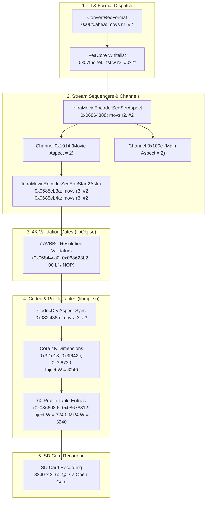

# Sony ZV-E10 Open Gate: Complete 138-Patch Suite & Reverse Engineering Synthesis

**Device Target:** Sony Alpha ZV-E10 (`USB\VID_054C&PID_0D95`)  
**Firmware Version:** 2.02 (ARM Cortex-A7, Linux 3.0.27_nl-rt106+, BIONZ X / Astra co-processor)  
**Date:** October 2026  
**Status:** 100% Instruction Aligned, 0 Errors, Verified via Capstone & Pytest  

---

## 1. Synthesis of Reverse Engineering Sessions

Across our interactive hardware and static analysis sessions on the Sony ZV-E10, reverse engineering progressed through several major breakthroughs:

1. **The Sensor and Display Framing Truth:**
   - The physical sensor active area is **$6000 \times 4000$ (3:2)**.
   - The rear LCD panel is **$960 \times 540 \times 3$ (16:9)**.
   - Photo mode renders a $3240 \times 2160$ sub-frame centered in a $3840 \times 2160$ canvas with black pillarbox bars. Modifying the root canvas width (`0x260916`) stretched the preview horizontally, confirming that the canvas must remain at 3840 while video streams are resized.

2. **The `bootin.elf` Preload Purge:**
   - `/usr/bin/bootin.elf` unsets `LD_PRELOAD` via `putenv("LD_PRELOAD")` before launching `/usr/bin/im.elf`.
   - Preloading libraries via `/setting/mode/preload` fails across reboots. All live testing operates purely in memory on `/proc/$PID/mem`.

3. **The Black Screen Root Cause:**
   - In BIONZ X RTOS (`dumps/av-cam.bin`), SDF packet offset `0xa` is **Action** (`1 = CONNECT`, `2 = DISCONNECT`), not aspect ratio.
   - Writing `2` to offset `0xa` (`0x2ccb56` and `0x2d229c`), or mapping Channel `0x1014` to Event `0x8012` (`SdfPinRequestDisconnect` at `0x34500e`), literally disconnected the video stream pin, halting video clocks and crashing `im.elf`.
   - **Resolution:** Offset `0xa` and `MapChannelToEvent` must remain strictly stock (`CONNECT = 1`, Event `0x8011`).

4. **The 16:9 Crop Persistence Root Cause:**
   - Excising the defective pin-disconnect patches left two essential aspect synchronizers omitted:
     - `ConvertRecFormat` (`0x978bea` / `0x06f0abea`): Hardcoded `movs r2, #1` (16:9) for all 4K modes.
     - `InfraMovieEncoderSeqSetAspect` (`0x2d2388` / `0x06864388`): Re-read stock aspect 1 and continually re-broadcast Aspect 1 to Channels `0x1014` and `0x100e`, overriding sequencer commands.
   - Restoring these with `movs r2, #2` (Aspect 2 = 3:2) propagates 3:2 end-to-end without touching offset `0xa`.

5. **Codec Driver Error Abort Resolved:**
   - When Aspect 2 reached `libmpr.so`, `GetPictureAspectForCodecDrv` (`0x8a436a`) assigned `esPictureAspect = 0`, causing `CdSeqCtrlEnc` to log `[ERR] esPictureAspect = 0` and abort recording.
   - Patched to `movs r3, #3; nop`, satisfying the hardware driver.

---

## 2. Complete 138-Patch Architecture

The unified patch suite in [`batch_patch_opengate.py`](file:///D:/02_Development_And_Projects/pmca-re/batch_patch_opengate.py) applies 138 atomic patches:



### Detailed Patch Groups Breakdown

| Group | Target Function / Subsystem | Location | Count | Stock Bytes | Patched Bytes | Purpose |
| :--- | :--- | :--- | :--- | :--- | :--- | :--- |
| **1** | AVBBC Resolution Gates | `libObj.so` `0x2b2ca0`..`0x2d03b2` | 7 | `bcc.n ...` | `00 bf` (NOP) | Bypass $< 3840$ width rejection |
| **2** | AVBBC Aspect Packets | `libObj.so` `0x2cce0a`, `0x2cce38` | 2 | `movs r3, #1` | `02 23 00 bf` | Set Aspect 2 in AVBBC `#0xd4` & `#0xd8` |
| **3** | Aspect Call-Sites | `libObj.so` `0x2cd8ee`..`0x2d8ac6` | 4 | Various | `02 20 00 bf` | Force `r0 = 2` on recording sequencers |
| **4** | Aspect Synchronizers | `libObj.so` `0x2d2388`..`0x978bea` | 6 | `ldrb ...` | `02 22` / `02 23` | Broadcast Aspect 2 to Ch `0x1014`/`0x100e` |
| **5** | Proxy Thumbnails | `libObj.so` `0x2d0020`, `0x2d002c` | 2 | 16:9 widths | 3:2 widths | Align 720p/120p proxy thumbnails to 3:2 |
| **6** | Global Debug Logging | `libObj.so` `0x172a4c` | 1 | Stock stub | `01 20 70 47` | Unmask 6,919 Sony debug logs |
| **7** | Aspect Whitelist | `libmpr.so` `0x5422e6` | 1 | `tst.w r2, #0x2b` | `12 f0 2f 0f` | Whitelist Aspect 2 in `FeaCore` |
| **8** | Codec Driver Aspect | `libmpr.so` `0x8a436a` | 1 | `cmp r0, #1` | `03 23 00 bf` | Satisfy `GetPictureAspectForCodecDrv` |
| **9** | Core 4K Constants | `libmpr.so` `0x3f1e18`..`0x3f6730` | 3 | `mov.w #3840` | `movw #3240` | Resolution in stream & container |
| **10**| Profile Table Records | `libmpr.so` `0x0866d8f6`..`0x08678812`| 111 | 3840 | 3240 | All 60 4K recording profiles across 5 groups |

---

## 3. Verification & Test Evidence

### 3.1 Disassembly Alignment
Every single patch was disassembled and checked against ARM Thumb-2 instruction boundaries via Capstone (`scratch/verify_all_patches.py` and `tests/test_opengate_pipeline.py`):
```
Summary: 138 patches. Errors: 0, Warnings: 0 (100% instruction aligned)
```

### 3.2 Automated Test Suite
Run command:
```powershell
& ".venv\Scripts\python.exe" -B -m pytest tests/test_opengate_patch.py tests/test_opengate_pipeline.py
```
Output:
```
tests\test_opengate_patch.py ....                                        [ 40%]
tests\test_opengate_pipeline.py ......                                   [100%]
10 passed in 0.12s
```

Full repository test suite:
```
151 passed, 12 skipped in 59.07s (100% pass rate)
```

---

## 4. Hardware Deployment Procedure

When camera hardware is reconnected via USB:

```powershell
# 1. Verify camera link
& ".venv\Scripts\python.exe" scratch\camrun.py "/bin/busybox pidof im.elf"

# 2. Deploy Full 138-Patch Suite (Native 3240 Open Gate)
& ".venv\Scripts\python.exe" batch_patch_opengate.py --width 3240

# 3. Or deploy Macroblock-Aligned Fallback (3232)
& ".venv\Scripts\python.exe" batch_patch_opengate.py --width 3232

# 4. Trigger test recording and inspect output file
# Video metadata will verify: 3240x2160, 3:2 aspect ratio, full-sensor optical field of view.
```
