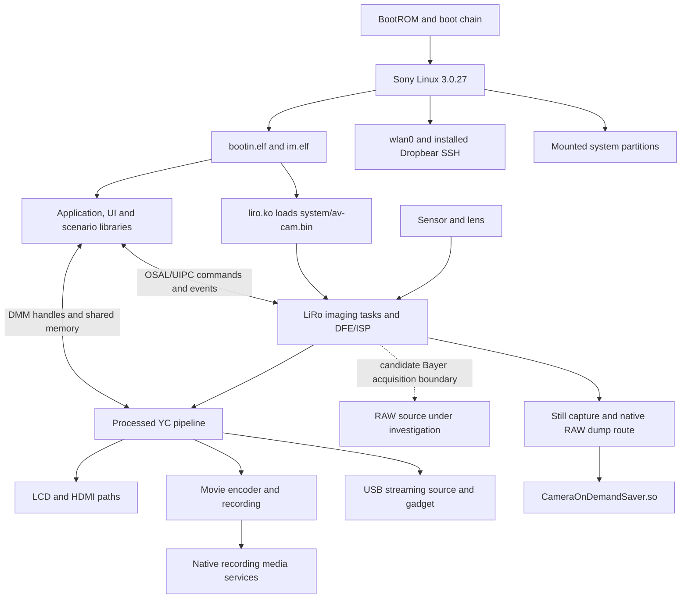

# ZV-E10 system overview

Reviewed 18 November 2026. Start here to understand the camera as a system. The [current status](CURRENT_STATUS.md) records the latest evidenced installation and the [access guide](ACCESS_AND_TOOLS.md) records how to inspect it. Research and camera experiments are paused while documentation is consolidated.

## System map

The diagram combines runtime observations with recovered firmware structure. Arrows express subsystem relationships. The complete per-frame route, buffer lifetime and hardware ownership at each arrow remain to be measured.

## Subsystem inventory

| Subsystem | What the evidence establishes | Evidence and remaining work |
| --- | --- | --- |
| Hardware platform | ARMv7, four Linux-visible Cortex-A5 cores in the hardware inventory, Linux 3.0.27_nl-rt106+, and Broadcom Wi-Fi support. | [Hardware inventory](reference/01-hardware.md). Linux-visible memory regions are documented there. Exact sensor model, full physical memory ownership and supported sensor readout modes need source-specific confirmation. |
| Boot and runtime | Normal shooting starts Linux application services and loads the camera image through LiRo. During the November SSH session, im.elf and LiRo coexisted. | [Boot and shell detail](reference/02-service-shell.md), [November runtime captures](../research/firmware/evidence/zve10-20261117/README.md). Process IDs and loaded-library addresses change between boots. Power-switch cycling can resume a session. Use uptime and boot ID to distinguish a fresh boot. |
| Linux application | im.elf hosts application, UI and subsystem libraries. libIMDB.so describes mode-dependent loading. libObj.so provides application models and objects. | [Binary inventory](reference/03-binaries.md), [messaging map](reference/04-messaging.md). A service-mode library list describes that mode and boot only. |
| LiRo imaging | av-cam.bin contains camera control and imaging stages. Scheduler/profile captures expose exposure, readout, camera-core and YC timing markers. | [Live pipeline evidence](CURRENT_STATUS.md). Which hardware operation each callback completes is still open. |
| Sensor, DFE and ISP | Offline analysis places sensor acquisition and DFE before MovItp and the processed YC path. Live-view SetImgRd repeats near 24 Hz in the sampled mode. | [Bayer audit](../research/firmware/raw_frame_source/verified_bayer/evidence/raw-pipeline-audit-20261031/REPORT.md). A live Bayer physical span, format, stride and safe completion-to-reuse interval remain unresolved. |
| DMM and dataflow | Shared-memory units and OSAL/UIPC connect producer and consumer subsystems. Captures show changing YC-related handles and additional recording-time units. | [DMM and hook verification](../research/firmware/evidence/zve10-20261117/CLAIM_REVIEW.md), [YC recovery audit](usb/uvc_sony_backend_recovery.md). A handle or mapping alone does not certify image format, producer completion or exclusive ownership. |
| Movie recording | Linux exposes MovieRecorder and AVCodec threads while LiRo imaging work continues. The user supplied 4K24 as the recording setting. | [Recording snapshots](../research/firmware/evidence/zve10-20261117/README.md). The captured counters do not measure encoded frame rate, dimensions or SD write throughput. Recording control, hardware encode and media service boundaries need correlation. |
| Still and RAW dumping | Firmware contains a native opened-buffer dump route to Linux endpoint 0x012802f1 and CameraOnDemandSaver.so. Offline receiver dispatch and gate tests exist. | [Native dump receiver](../research/firmware/raw_frame_source/verified_bayer/evidence/native-dump-20261031/REPORT.md), [later gate correction](../research/firmware/raw_frame_source/verified_bayer/evidence/raw-pipeline-audit-20261031/REPORT.md). One-shot activation and a real saved Bayer frame remain unverified. |
| LCD, UI and graphics | UI models, resources and GRM rendering form a separate layer from image acquisition. VGA colour bars over USB validate the custom transport source. | [UI formats](reference/05-formats.md), [application and graphics inventory](reference/03-binaries.md), [colour-bars report](usb/uvc_yuy2_patch_v24p.md). Rendering an owned RAM buffer in emulation has not demonstrated physical LCD scanout. |
| USB | MSC, service/Senser, updater, PTP and streaming modes have different entry paths. UVC source, staging DMA, gadget and host capture each need their own checks. | [Interface inventory](reference/08-camera-interfaces.md), [USB lifetime audit](../research/firmware/raw_frame_source/verified_yc/evidence/usb-lifetime-20261029/REPORT.md). Enumeration and advertised rates alone cannot establish throughput or complete frames. |
| Wi-Fi and remote access | The installed Dropbear SSH service accepted pinned key authentication over the Windows hotspot during normal shooting and recording. | [Access and tools](ACCESS_AND_TOOLS.md). This route depends on the installed Linux services, networking and boot path. Operation after removing LiRo has not been demonstrated. |
| Lens, exposure and focus | Lens control uses the internal CAIF/LIF path. Exposure and lens-related tasks appear alongside image processing markers. | [Lens interface](reference/08-camera-interfaces.md), [command vocabulary](reference/04-messaging.md). Names and command acceptance do not prove an actuator effect. |
| Storage and recovery | Linux exposes flash-backed partitions for root, usr, settings, logs, system and lens data. Native media services can operate beyond Linux-mounted files. | [Mounts and persistence](reference/07-modification.md), [recovery scope](ACCESS_AND_TOOLS.md). Preserve per-body backups and calibration. The available BootROM recovery route has a defined partition scope and technical prerequisites. |

## Image-pipeline questions

The project goal is Bayer RAW over USB. The next research milestone is an observed frame lifecycle that identifies source format, producer completion, buffer address/handle, consumer handoff and reuse. The evidence currently establishes repeatable firmware timing and DMM activity. It has yet to associate those observations with one specific Bayer frame.

Resolve these in order when camera work resumes.

1. Identify the live sensor mode and distinguish sensor readout cadence from preview timing and displayed frames.
2. Associate one DFE operation and completion event with its output buffer and the matching MovItp consumer.
3. Recover dimensions, stride, packing, bit depth and colour filter arrangement from metadata and payload validation.
4. Establish buffer ownership, cache visibility and overwrite timing before copying or queuing bytes.
5. Correlate the processed YC preview branch, movie encoder branch and still-capture branch using frame or operation IDs.
6. Integrate the validated source with the transport, then measure negotiated link speed, complete host frames and sustained delivery.

## Reading order and evidence

Use [current status](CURRENT_STATUS.md) for the latest checkpoints, [access and tools](ACCESS_AND_TOOLS.md) to reproduce inspections, then the subsystem links above. The numbered topic documents retain detailed historical investigation. Dated session logs and candidate READMEs carry the state observed at their dates.

Use these evidence labels when adding a result.

| Label | Required support |
| --- | --- |
| Hardware observed | Dated capture, mode, boot/process identity where relevant, and a path to the raw result. |
| Offline verified | Exact input identity and the original-instruction test, static analysis or source check. Record mocked services. |
| Candidate | Implementation or proposed hook with the hardware-dependent parts stated explicitly. |
| Open | A question whose evidence is missing or insufficient. |

An installation readback establishes installed bytes. A descriptor establishes an advertised mode. Timing markers establish firmware events. A successful pixel capture and sustained delivery measurement require their own evidence.
