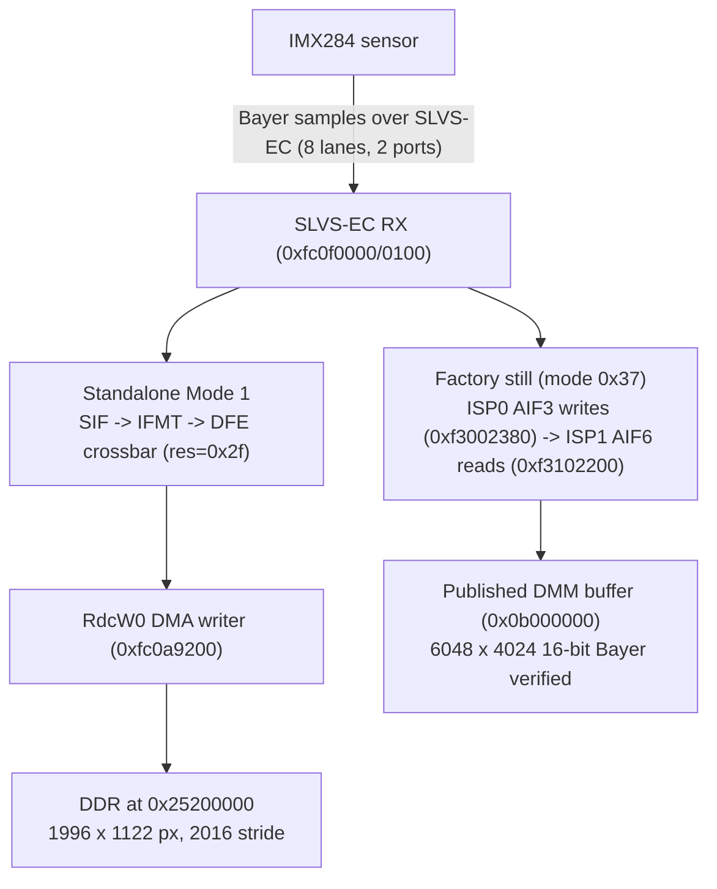

# ZV-E10 Sensor Pipeline (`IMX284` + `CXD90057` DFE / SLVS-EC / AIF)

**Updated:** 28 November 2026  
**Target:** Sony ZV-E10 (`CXD90057` SoC + `IMX284` 6048x4024 Bayer sensor)  
**Primary firmware reference:** `av-cam.bin` (load base `0x635c6000`, SHA-256 `bc6cba98c1ce5ef9c7692b9701ed855c25958d285a646ef90dc3fdf398f5c4fa`) and `dfe_dat.bin` (`65,536` bytes ARM coprocessor image embedded at `0x64560700`)  
**Scope & provenance:** Combines Ghidra 12.2 / Rizin (`pdg`) decompilation of `av-cam.bin`, Unicorn original-instruction replays, passive and active USB Senser MMIO traces (`stock-reg-diff-03/04`, `stock-trace-ee-02`, `sgc0-factory-passive-01`, `cold-warm-exp-01..35`), and cross-check against Sony a6400 (`ILCE-6400`) firmware. Address spaces stay strictly separated: physical MMIO (`0xf2xxxxxx`/`0xf3xxxxxx`/`0xfcxxxxxx`), firmware VAs (`0x635c6000+`), DFE coprocessor VAs (`0x01000000+`), and physical DDR DMA destinations (`0x0b000000` / `0x25200000`).

---

## 1. Overview & End-to-End Architecture

The ZV-E10 sensor readout path spans IMX284 power rails, P2S serial SPI configuration, 72 MHz DFE/CamCore timing generators (`DrvSGC0`, `SyncSequencer`, `SGC1..3`), ComboPHY/AFE/MPHY/SLVS PHY physical links, the 8-lane dual-port SLVS-EC receiver, and two separate Bayer RAW DMA routes into DDR:

1. **Standalone Mode-1 path (`res=0x2f`):** `IMX284` -> 8-lane `SLVS-EC` -> `SIF` -> `IFMT` (`Ifmt_RcvSgc`/`Ifmt_LnkSgc`/`Ifmt_Win`) -> `DfeTop` crossbar (`0x03 -> 0x1c`) -> `RdcW0` (`0xfc0a9200`) -> `0x25200000` (`1996x1122`, stride `2016` pixels = `4,523,904` bytes).
2. **Stock factory still path (`adjstctl.elf 0x404 0x4e`, mode `0x37`):** `IMX284` -> `SLVS-EC` -> `ISP0 AIF3` write (`0xf3002380`) -> `ISP1 AIF6` read (`0xf3102200`) -> retained DMM buffer (`0x0b000000`, `6048x4024` 16-bit LE Bayer = `48,674,304` bytes in `48 MiB` extent `0x03000000`). **Hardware-verified.**

### Startup & First-Frame Stall Boundary

```mermaid
sequenceDiagram
    participant R as Standalone runner
    participant P as PMIC & DFE clocks
    participant T as SGC0 & SyncSeq
    participant S as IMX284 sensor
    participant L as SLVS-EC receiver

    R->>P: Raise sensor rails, enable clocks, start DFE coprocessor
    P-->>R: Mailbox ready (state 0xff, timer gates 0x003c0006 / 0x00020000)
    R->>T: Initialize 72 MHz timing domain (DrvSGC0 + SyncSeq + SGC1)
    R->>L: Configure ComboPHY, AFE, MPHY lanes, SLVS-EC RX ports
    R->>S: Wake and configure Mode-1 over P2S SPI
    S-->>R: Six software-triggered SPI bursts completed
    R->>T: Program Mode-1 timing (0x00012ac8, 0x026a0793) and queue SPI #7
    R->>T: Assert SGC0 start request (0xfc0a1110[0] = 1)

    alt Observed in cold-warm-exp-34/35
        Note over T: Request latched (0xfc0a1110 = 1)<br/>Active bit 16 stayed clear; HVcnt=0x3fff3fff<br/>SyncSeq stayed at 0x00ee466c
        T-->>R: Frame-sync SPI #7 timed out
        Note over L: Receiver stayed unlocked (0xfc0f00b0 = 0)
    else Observed on stock Mode-1 / Factory still
        T->>S: Frame event updates SyncSeq & releases SPI #7
        S->>L: Sensor streams SLVS-EC packets
        L-->>R: Receiver locks (0xfc0f00b0 = 1)
    end
```

### Bayer Pixel Dataflow



### Causal Bring-Up Timeline (`stock-trace-ee-02`, Mode-1 LiveView)

Stock EE brings up sensor timing, SPI streaming, and the SLVS-EC link **before** enabling `DfeTop`, the crossbar, `IFMT`, or `RDC`:

| Timestamp | Phase | Verified Hardware Events & Registers |
| --- | --- | --- |
| `548.930 ms` | **1. Pre-arm & sensor wake** | `0xfc08010c` clears bit 0 (`3 -> 2`). PHY/MPHY active (`0xfc02a008=0x1101`, `0xfc02a06c=0x0012007c`, `0xfc02a080=0x0`, `0xfc02d00c=0x11`, `0xfc02d010=0x1`). `0xfc0a0000` held at `0x160`. `IMX284 wake` (`0x637ad310`) drives `0xfc029028: 0x70 -> wake_0 (12 ms) -> wake_1/2 (6 ms) -> 0x7e (20 ms)`. |
| `682.554 ms` | **2. SyncSeq, SGC0 & `mode_2` SPI** | `0xfc0800f4 = 0x00012ac8`, `0xfc080028 = 0x00fffffc`, `0xfc080030` steps `0x00fffffc -> 0x0012542e -> 0x0012542c`. `SGC0` Mode 1 (`1120=0x026a0793`, `1124=0x0206`, `11a8=0x026b0001`, `11ac=0x00110061`) activates: `0xfc0a1110 = 0x00010001` **while `DfeTop` is still off**. `IMX284` receives `mode_2` SPI (`0x0832=0x03, 0x03, 0x00 ...`) synchronized to active XVS/XHS. |
| `694.125 ms` | **3. SLVS-EC RX lock** | `0xfc0f00b0` transitions to `1` (`+11.6 ms` after `SGC0` active, `18.7 ms` **before** `DfeTop`/`IFMT`/`RDC` turn on). |
| `712.864 ms` | **4. `DfeTop`, Crossbar & DMA** | `0xfc0a0000` switches `0x160 -> 0x172` (`0x160 | 0x02 | 0x10`), `0xfc0a0200/04 = 0x11`, Mode-1 preview crossbar (`0xfc0a0150=0x02000000`, `0xfc0a0178=0x00020000`), and `IFMT`/`RDC` (`0xfc0a1200/1300=1`) enable frame readout. |

---

## 2. Subsystem Register Contracts (`av-cam.bin` Ghidra / Rizin Verified)

### 2.1 SoC CRG (`0xf2900000`, `0xf2a00000`, `0xf2a30000`)

| Clock ID / Function | Target MMIO & Operation | Notes |
| --- | --- | --- |
| `SOC_CLK_SLVS_IMAGER (0x3b)` | Enable (`0x63a26e34`): `0xf2a30044 = BIT(9)`, `0xf2a30064 = BIT(24)`, `0xf2a300a4 = BIT(10)`. Disable (`0x63a25914`): `0xf2a30068 = BIT(24)`, `0xf2a300a8 = BIT(10)`. | Active `0xf2a30060` readback in `EE-02` = `0x91071111`; bit `0x00100000` in `EE-04` is `clk_id 0x3a` (optional for Mode-1 lock). |
| `SOC_CLK_PMIC_SPI (0x4e)` | Enable (`0x63a26438`): `0xf2a300b4 = BIT(27)`, `0xf2a30034 = BIT(11)`. Disable (`0x63a25914`): `0xf2a30038 = BIT(11)`, `0xf2a300b8 = BIT(27)`. | Acquired during rail bring-up/wake; kept active while streaming (`0xf2a30030[11]=1`, `0xf2a300b0[27]=1`). Note `0xf2a30038 BIT(27)` belongs to `clk_id 0x38`, not `0x4e`. |
| `SGC1` clock (`0x63a2551c`, `0x63dbb4fe`) | Divider at `0xf2a01140`: `0x08` (72/108 MHz), `0x0b` (54 MHz), `0x1a` (24 MHz). Ungate via `0x63dbb4fe(0)` (`0xf2a00008 = 0x10000`). | Fallback frequency sets `0xf2a00028`/`0xf2a00004` rather than writing `0x10000` to `0xf2a01140`. |

### 2.2 PMIC, Imager GPIO & Power Sequencing (`0xfc029000..2c`, `0xfc02a0d0`, `0xf2403b00`)

- **GPIO addressing:** `pin = bank * 8 + bit`; `EN` at `0xfc029000 + 4*bank`, `DIR` at `+0x10`, `LVL` at `+0x20`.
- **Rail power-on (`0x637ad800`, Backup property `0xbc0014`):** Acquires PMIC SPI (`0x4e`), preserves cold `IMX284_PIN_PWR_KEEP` (bank 1 bit 1 = `0x02`), sets pad drive `0xfc02a0d0 = 0x00aaaaaa`, steps power-enable pins with hardware timer channel `0xb` (`0xf2403b00`, `0x63a92bb0`/`0x63a92c04`) delays (`9.4 ms`, `1 ms`, `9.4 ms`, `12.4 ms`, `12.4 ms`, `12.4 ms`), then releases `0x4e`.
- **Wake (`0x637ad310`):** Acquires `0x4e`, drives wake-A pins (`0xfc029028: 0x10 -> 0x50 -> 0x70`), uploads `wake_0` twice -> `12 ms` -> `wake_1` & `wake_2` -> `6 ms` -> drives wake-B pins (`0xfc029028: 0x74 -> 0x76 -> 0x7e`) -> `20 ms`. Active stock bank 2 reads `EN = 0x77` (bit 3 clear), `LVL = 0x7e`.
- **Reverse power-off (`0x637ab9fc`):** Sets pin `6` high then walks down rails (`16`, `18/17/19/20/22/21` EN/LVL clear, `14/12`, `15`, `6`, `7`, `13`, `5`) with stepped waits before releasing `0x4e`.
- **SoC PMU (`0xf290e004/008`):** `upm.ko` (DDR-B transition) clears `0xf290e004/008`; in stock `EE-02` both remain `1` through SGC0 activation and SLVS lock (only transitioning at `1082.583 ms`).

### 2.3 P2S SPI Sequencer (`0xfc088300/e00/f00`) & IMX284 Protocol

- **Packet encoding (`0x63d2aa56`, `0x63d2aa8a`, `0x63d2a31e`):** Each coalesced run of `(u16 reg, u8 val)` writes emits `[0x81, 3 + run, 0x81, reg_hi, reg_lo, val_0..val_{run-1}]`, splitting across address page boundaries and ending with `0x00`. Encoded in [imx284_sensor.h](../../research/device/zve10_ram_boot/imx284_sensor.h).
- **Execution modes:** Run mode `2` (`0xfc088e00`) is software-triggered (used for wake bursts 0..2 and Mode-1 prep bursts 0..1); run mode `0` is frame-synchronous on XVS/XHS (used for the 48-write stream commit `mode1_regs_2` starting with the `0x0832` latch `0x03 -> 0x03 -> 0x00`).
- **IRQ arbitration:** Core 1 RTOS steals `0xfc088f04` completions when `0xfc088f08 = 1`; bare-metal Senser polling clears `0xfc088f08 = 0` and polls `(0xfc088f00 | 0xfc088f04) & 1`.
- **Native table pool:** Mode pointer arrays sit at `0x645bc738` / `0x645bc804` indexing `(u16 reg, u16 val)` entries at `0x6461861e..0x64618916`. `0x637abea4` computes the repeated `0x0832` stream-latch word (`3` when link mode=3 and setting=`0xff`). Per-shot exposure parameters flow `0x63c047c8 -> 0x63bbe150 -> 0x63c04bf4 -> 0x6448139c -> SetImgRd (0x637aca24)`.

### 2.4 DFE Coprocessor (`dfe_dat.bin`, `0xfc0300f4/f8/fc`)

- **Loader & entry:** `0x639daeb4` / `0x639dfb38` loads the `65,536`-byte ARM binary embedded at `0x64560700` (identical to `.local` `dfe_dat.bin`). Host rings doorbell `0xfc01e018 BIT(27)` after programming `0xfc0300f4` (cmd), reading `0xfc0300f8` (`bits[5:4]` busy mask, `bits[15:8]` state: `0xff`=run, `0xfe`=idle), and setting `0xfc0300fc` (`BIT(28)` run, `BIT(20)` stop req, `BIT(16)` abort, `0x63da0880` command latch read/clear).
- **Side effects:** Starting the coprocessor to state `0xff` enables `0xfc098808 = 0x003c0006` and `0xfc098908 = 0x00020000`. Inside `dfe_dat.bin`, `0x0100030c` / `0x01000778` handle script events `0x08`/`0x10` over shared script table `0x01036d00` (`0xfc036d00`).

### 2.5 DFE CRG, PLLs, D-PHY PLL & SLVS PHY

- **DFE CRG (`0x63d23710`, `0x63d23620`):** Sets `0xfc020028 |= 0x1b` (`|= 0x20` when MIPI/D-PHY needed) and updates **only bits `[7:0]`** via RMW (`*r = (*r & 0xffffff00U) | val`) across `0xfc020104..0xfc020194` (preserving the hardware upper mirror bytes such as `0x37000037`, `0x9f00009f`, `0x7f00007f`). Sets `0xfc02a008 |= 1` via `0x6379e5ec`.
- **DFE PLLs (`0x6379e6c4`):** Enables PLLs `0..2` (`0xfc021000[0,4,8]`), polls lock bits (`0xfc021050/54/58` bit 0), writes divider code (`0=144, 1=72, 2=108, 3=54 MHz`) to `0xfc02100c/10/14`, and clears **only** reset bits `0x0002083c` (`bits 2,3,4,5,11,17`) in `0xfc021024` (leaving `BIT(6)` for `DrvSGC0` `0x63d267a4` and `BIT(12)`/`BIT(14)` for `SIF0` `0x637a0090`).
- **MIPI/D-PHY PLL (`0x637a19dc`):** Sets `0xfc02a070 = 1`, `0xfc02a06c` (`bit 12 = 0`, `[6:0] = 0x7c`, `[11:8] = 0`), `0xfc02a068 = 1`, `0xfc02a060 = 1`, `0xfc02a064 = 0x1111` (checking readback after each write), then polls **`0xfc02a080 & 1`** (`DFE_DPHY_AUX` via `0x63d24ada`) — **not** `0xfc02a074` — and clears `0xfc02a080 |= 1` (`0x63d24ae2`).
- **SLVS PHY (`0x63d24b54`) & Bridge (`0x637a2598`, `0x63d272d4`):** Writes `0xfc02d000..44` including termination constants `0x0e0c350b` / `0x0f0d170a`, waits `100` OS ticks (`FUN_637a1654(100,0)`), writes `0xfc02d00c = 0x11`, `0xfc02d010 = 1`. `SUB_637a2598` enables `0xfc0a0200 = 0x10`, `0xfc0a7000 = 1`, `0xfc0a7004 = 1`; `0x63d272d4` enables `0xfc021008 = 1` and `0xfc098800 = 2, 1`.

### 2.6 ComboPHY, AFE, MPHY & SLVS-EC RX

- **ComboPHY & AFE (`0x637a76b8 -> 0x63d2a15e -> 0x637a74e0(100) -> 0x63d2a04a -> 0x637ae818`):** Tears down any prior ComboPHY state (`0x637a76b8`), pulses `0xf292a010 = 0` (3x), releases SoC resets/clocks on `0xf29000xx`/`0xf2a000xx`/`0xf2a300xx`, sets `0xf292a044 = 4`, `0xf292a074 = 0 -> 0x100`, waits `100 us`, configures AFE (`0xf2931104=0x0f -> 1100=3 -> 112c=0 -> 1130=0x10000 -> 1104=0`), and toggles `0xfc02d00c/10` (`0x13/0 -> 1 us -> 0x11/1`).
- **MPHY lane groups (`0x63d2a240`, `0x63d2a29a`, `0x63d2a274`, `0x63d2a2b8`):**
  - `0xfc02a008` enables `|= 0x100` then `|= 0x1000`.
  - **`0xfc02a040` is a global control register** (`0x63d2a29a` clears bit 0 when set and loops `400` times; `0x63d2b6ee` sets bit 0 during stream stop/reset).
  - **`0xfc02a050` is read-only status** (`0` code references in `av-cam.bin`, reflects `0x0f` when group 1 lanes are enabled).
  - Group 0 uses `0xfc02a044` (mode nibble `[3:0]=3`, `[11:8]=0`), `0xfc02a048` (reset bit 0), `0xfc02a04c` (lane enable `0x0f`); Group 1 uses `0xfc02a054`, `0xfc02a058`, `0xfc02a05c`. `0x63d2a274` waits `0xc80` loop iterations after `0xfc02a048/58 |= 1` before setting lanes.
- **SLVS-EC RX (`0x637aeae0`, `0x637aebd0`):** Programs common protocol defaults (`0xfc0f0008..c8`), stops both ports, relocks MPHY lanes, configures active ports (`0xfc0f00c4=3`, `0xfc0f01c4=2`, `0x0f` on `+0x74`), releases `0xfc0f0000` in four stages (`0x01000000 -> 0x01030000 -> 0x0103ff00 -> 0x0103ffff`), and sets `0xfc0f0050 = 1`, `0xfc0f0150 = 1`. Lock indicator is `0xfc0f00b0 & 1`.

### 2.7 `DrvSGC0` (`0xfc0a11xx`) & `SyncSeq` (`0xfc0800xx..114`) Bit-Field Map

Decoded directly from `0x63d267a4`, `0x63d26a42`, `0x63d26acc`, `0x637a4278`, `0x6379cf04`, `0x6379cedc`, `0x637a4324`, `0x637a3858`, `0x635c8628`, and `0x63d25de4`:

| MMIO | Field / Bitmask | Mode-1 Value | Decoded Meaning |
| --- | --- | --- | --- |
| `0xfc0a1100[0]` | Block enable | `1` | Local `DrvSGC0` enable (`0x63d267a4`, after clearing `0xfc021024[6]` and setting `0xfc0a0000[8]`). |
| `0xfc0a1140[2:0]` / `[18:16]` | VD / HD output selectors | `0x00040007` | Low `[2:0]`: `7` when VD width > 0 (`6` when 0). High `[18:16]`: `4`. |
| `0xfc0a114c[13:0]` | VD pulse width | `4` | Set directly by `0x63d26a42(..., v_pulse=4)`. |
| `0xfc0a1150[13:0]` / `[29:16]` | HD start / end edges | `0x00250005` | `[13:0] = SensHDTim + 2 = 5`; `[29:16] = 5 + hd_width(32) = 37 (0x25)`. |
| `0xfc0a110c`, `1194[16]`, `1198[16]` | Output config commit | `1`, `0x10000`, `0x10000` | Written at end of `0x63d26a42` after edge positions. |
| `0xfc0a1120[13:0]` / `[29:16]` | `(H - 1)` / `(V - 1)` | `0x026a0793` | Zero-based H (`1939`) and V (`618`) terminal counts = `1940 x 619`. Idle = `0x03470595` (`1430 x 840`). |
| `0xfc0a1124` | `V - 101` | `0x00000206` | `619 - 0x65 = 518 (0x206)`. |
| `0xfc0a11a8[0]` / `[29:16]` | NLR enable / V_alt | `0x026b0001` | Bit 0 enables fractional-line NLR; `[29:16] = nlr_delta(1) + V - 1 = 619 (0x26b)`. |
| `0xfc0a11ac[23:16]` / `[7:0]` | NLR numerator / denom | `0x00110061` | `(619 + 17/97) * 1940 = 1,201,200` (`0x125430`) timing clocks/frame (`2000/1001 * 60` Hz). |
| `0xfc0a112c[0]` | `rpt` (repeat) | `1` (LV) / `0` (Still) | Repeat mode flag in `0x637a4278` (LV Mode-1 sets `1`, factory still sets `0`). |
| `0xfc0a1130[16]`, `1108[0]`, `1110[0]` | Start trigger selector | `1110=1`, others `0` | Selector `1`: `1130[16]=0`, `1108[0]=0`, `1110[0]=1`. Selector `2`: sets `1130[16]`. Selector `0`: sets `1108[0]`. |
| `0xfc0a1110[16]` | HW active status (RO) | `1` (`0x00010001`) | Read by `0x637a3f60`; rises once SGC0 counters actually run. |
| `0xfc0a113c[0]` / `119c[16]` | VD0 mask / sync opt | `0` / `0` | Cleared pre-start by `0x63d736ec -> 0x6379cf04` (`113c[0]`) and `0x63d736e6 -> 0x6379cedc` (`119c[16]`). |
| `0xfc0a1114->1118`, `111c->1128` | `HVcnt`, `Fcnt` latches | `0x3fff3fff` (stalled) | Diagnostic `0x637a4324`: `0x63d26a24` latches HV to `1118`; `0x63d269fa` pulses `111c[0]` and reads frame low byte `1128[7:0]`. |
| `0xfc080028` / `0xfc0800f4` | `SyncSeq` period / trig | `0x00fffffc` / `0x00012ac8` | `0x635c8628`: `1201200 - 72 * 15621 = 76,488 = 0x12ac8` (preview) or `0` (one-shot still). |
| `0xfc080030` | Live frame interval (RO) | `0x0012542b..2e` | First reads `0x00fffffc` on reload, then latched 72 MHz frame ticks (~`0x125430`). Stalled runs stay at cold `0x00ee466c`. |
| `0xfc080014`, `0xfc080104..114` | Soft pulse & IRQs | `1->0` / `114=1` | `0x63d25de4` pulses `0x80014=1`, `0x80028=0x40`, `0x80014=0`; `0x6379cf40` resets `SGC0` after. `0x80104/110` W1C, `0x80108/114` mask. |

### 2.8 CamCore `SGC1` (`0xf3120000..26c`, `0xf3000038`)

`FUN_637787f0`, `FUN_637769e0`, and `FUN_63778410` (`dfeSgc1.cpp`):
- Init sets `0xf3120234 = 0x30005`, `0xf3120238 = 3`, `0xf3120110 = 0x0f`, `0xf3120100 = 2`, `0xf3120074 = 0xff000300`, `0xf3120120 = 0x1f`, and inactive `0x3ffe3ffe` delays on `0xf3120248/4c`.
- Mode-1 uses `case 1` (external/slave sync route matching `warm_act`): `0xf3120038 = 0x101`, `0xf3000038 = 0x10101` (bit 0 = 1!), `0xf3120210 = 0x101`, `0xf3120220 = 0x026a0793` (`((V-1)<<16)|(H-1)`), `0xf3120224 = 0x206` (`V-1-100`), `0xf3120264 = 0x026b0001`, `0xf312026c = 0x00110061`. *(Note: master `case 4` clears bit 0 on `0xf3120038`, sets `0xf3120210 = 1`, and writes `0xf3120224 = V - 1 = 0x26a`.)*

### 2.9 `DfeTop`, Crossbar, `SIF`, `IFMT`, `RdcW0` & Stock `ISP0/ISP1` RAW DMA

- **`DfeTop` W1S/W1C (`0xfc0a0000/04`, `0xfc0a0200/04`):** Never RMW `0xfc0a0000`; write single-bit masks (`BIT(1)` IFMT, `BIT(4)` SIF, `BIT(5)` SyncSeq, `BIT(6)` PIN, `BIT(7)` RDC, `BIT(8)` SGC0, `BIT(15)` AIF). Mode-1 RAW DMA requires `BIT(7)` (`RDC`) and `BIT(15)` (`AIF`) in addition to `IFMT | SIF`.
- **`SIF0` reset bracket (`0x637a0090`):** Assert `0xfc021024 |= BIT(12)` (`0x0005b783`) -> write `0xfc0a3000 = 1`, `0xfc02101c = 1`, `0xfc0a3214 = 0x00200000` -> clear `BIT(14)` and `BIT(12)` (`0x0005a783`).
- **Crossbar (`0x6379df58`, table `0x63f6760f`):**
  - Native Mode-1 RAW (`res=0x2f`): `0xfc0a0154 = 0x40000000`, `0xfc0a0180 = 0x00010000`, `0xfc0a8700 = 0x00000100`.
  - Mode-1 LiveView preview: `0xfc0a0150 = 0x02000000`, `0xfc0a0178 = 0x00020000`.
- **`RdcW0` (`0xfc0a9200`):** `0xfc0a9220 = 0x25200000` (dest PA), `0xfc0a9224 = 0x00000f98` (`1996 * 2`), `0xfc0a9228 = 0x00000028` (`(2016 - 1996) * 2`), `0xfc0a922c = 0x00000461` (`1122 - 1`).
- **Stock Factory Still `ISP0/ISP1` (`0xf3002380`, `0xf3102200`):** Writes `0x0b000000`, `0x2f40` (`6048 * 2`), `0`, `0x0fb7` (`4024 - 1`). Monitored on `ISP0` IRQ 37 (`0x63d0fe38`, `0xf3000048`: `0x04000000 -> group 0x16 bit 0x80`, `0x08000000 -> bit 0x20000`) and shared ISP IRQ 36 (`0x637777c0`, `0xf3120048/4c`: tag `0x10000000 -> group 0x16 bit 0x02`), with final DMM publication in `0x63d8fd52`.

---

## 3. Stock Linux-to-RTOS Dispatch & Dual `SGC0` Start Paths

Traced across the Linux-to-RTOS OSAL boundary via Rizin `pdg` and Thumb disassembly on `av-cam.bin`:

| Stock Trigger | OSAL / `av-cam.bin` Call Chain | Resulting `SGC0` / `SyncSeq` Behavior |
| --- | --- | --- |
| `scenario.elf CAMERA_SCN_EE_START_STOP b:1 b:0` | Configures display path -> sends `SetEE` type `0`, mode `0x3003` to OSAL `0x00030001` -> `0x63916a74 -> 0x639196b8` queues internal cmd `2` on `0x000302d9` -> worker `0x6391a25c -> 0x63d8d6e2 -> 0x639152d0` -> `SyncTask` HS callback `0x635ce230 -> 0x638d15c4` | **Repeating LiveView start:** `rpt = 1` (`0xfc0a112c = 1`), `0xfc0800f4 = 76,488 (0x12ac8)`, programs Mode-1 H/V counts, asserts `0xfc0a1110[0]`. |
| `adjstctl.elf 0x404 0x4e` | Sends `C_RAWDATA_CAP` (`0x404`/`0x4e`) to OSAL `0x000301d7` -> `0x6391cd28 -> 0x6391c660 -> 0x63af4890` -> mode `0xa00a` -> `0x639152d0` -> lane 2 wait + two lane 0 waits -> still worker `0x638ff67c` -> `0x638ffa54 -> 0x63907474 -> 0x638d146c` | **One-shot still start:** `rpt = 0`, `0xfc0800f4 = 0`. Activates `SGC0` twice (low cycle field `285` then `4,148` ticks; upper field `1,260`), then restores preview timing. |

Note: `DrvSGC0` also exposes a virtual start slot at vtable `+0x08` (`0x63d269f2`) calling `0x637a4278` with selector `1`, `rpt = 0`.

---

## 4. Hardware Bring-Up Milestones & Current Blocker

Detailed chronological logs live in [zve10_ram_boot/SENSOR_PIPELINE.md](../../research/device/zve10_ram_boot/SENSOR_PIPELINE.md) and [BAYER_HANDOFF.md](../../research/device/zve10_ram_boot/BAYER_HANDOFF.md).

| Campaign | Outcome | Key Evidence |
| --- | --- | --- |
| `senser-bayer-test-06..14` | **7/7 SPI + SGC0 + SLVS-EC lock** | With Mode-5 seed + leaked EE preview state (`test-05` partial start), reached `I=7 T=0`, `SGC0..3=0x00010001`, `0xfc0f00ac=2`. Zero pixels (crossbar missing). |
| `senser-bayer-test-20/23-rdcw0` | **Crossbar & `RdcW0` verified** | Against stock preview, adding `0154=0x40000000`, `0180=0x00010000`, `8700=0x100` made `RdcW0` go busy (`0x80000000`, cursor `0x25200000`), though Core 1 ISR overwrote `SGC2`. |
| `senser-bayer-test-33..35` / `cold-warm-exp-05..25` | **Cold Mode-1 & `0x37` strip baseline** | Clean cold reboots reached `DfeTop=0x11`, `CRG2=0x15`, valid `RdcW0` geometry & crossbar, `I=6 T=0`, then stalled at `SGC0=1`, `0xfc080030=0x00ee466c`, SPI #7 timeout. |
| `cold-warm-exp-26..35` | **Behavioral driver refactor & SGC0 isolation** | Left PMU `0xf290e004/008=1` under kernel control, confirmed DFE mailbox `0xff` + `0xfc098808=0x003c0006` + `0xfc098908=0x00020000`, fixed SGC1/MPHY/SIF0/DPHY behavioral drivers (audit items verified), matched **79/80** `SyncSeq`, **63/64** `SGC0`, and **64/64** `DFE PLL/CRG` words vs active stock. Run 34–35 still measured `HVcnt=0x3fff3fff`, `Fcnt=0x7c`, `0xfc0a1110[16]=0`, `0xfc080030=0x00ee466c`, SPI #7 timeout. |
| `sgc0-factory-passive-01` | **Passive stock still capture** | Proved stock starts and restarts `SGC0` with **zero sampled change** in the three PLL lock bits, divider fields, or `0xfc021024` reset. `SGC0` active bit + `SyncSeq` update appeared `~6 ms` after request; `SLVS-EC` lock + `ISP0 AIF3` DMA (`0x0b16b3c0..0x0d8d6480` -> DMM `0x0b000000`) appeared `~20 ms` later. |

### Exact Isolated Blocker

The earliest hardware divergence in standalone Mode 1 is strictly bounded to **`DrvSGC0` start qualification / local clock delivery (`0xfc0a1110[0] -> 0xfc0a1110[16]`)**:
- All 64 sampled DFE PLL/CRG words, SGC0 timing words (`0x026a0793`, `0x0206`, `0x026b0001`, `0x00110061`), and 79/80 `SyncSeq` words match active stock; mailbox reaches `0xff`; PMU `0xf290e004/008 = 1`.
- Yet `0xfc0a1110[16]` stays `0` and `HVcnt`/`Fcnt` never advance (`0x3fff3fff`/`0x7c`).
- Next trace target: decompile what `SyncTask` (`0x635ce230 -> 0x638d15c4`) executes immediately before asserting `0xfc0a1110[0]`, and resolve the local clock gate or start condition between the 72 MHz divider and `SGC0`'s counters. Separately, the behavioral driver audit identified fixes in [cxd90057_pipeline.h](../../research/device/zve10_ram_boot/cxd90057_pipeline.h) / [senser_bayer_runner.c](../../research/device/zve10_ram_boot/senser_bayer_runner.c) (notably MPHY group offsets vs global `0xfc02a040`, SGC1 `case 1` route/H-V packing, `DFE_CORE_BIT_RDC | AIF`, SIF0 reset bracket on `0xfc021024`, `0xfc02a080` D-PHY poll, and `SOC_CLK_PMIC_SPI` disable bit `BIT(11)`).

---

## 5. Sony a6400 (`ILCE-6400`) Firmware Cross-Check (2026-11-28)

Cross-checking `6400a/nflasha3.bin` against ZV-E10 firmware shows nearly 1-to-1 hardware and driver parity across the entire imaging front end:

| Artifact (`nflasha3.bin`) | a6400 (`6400a`) | ZV-E10 | Comparison |
| --- | --- | --- | --- |
| `DFE_DAT.BIN` | `65,536` B (`703f457a480eee74`) | `65,536` B (`703f457a480eee74`) | **100.00% bit-identical** |
| `BONOBO.BIN` | `172,144` B (`a9e739bc28aa`) | `172,144` B (`a9e739bc28aa`) | **100.00% bit-identical** |
| `LIF_APP.BIN` | `6,716` B (`5e1ebaa18e49`) | `6,716` B (`5e1ebaa18e49`) | **100.00% bit-identical** |
| `AV-CAM.BIN` | `16,822,380` B (`3029a174b393fee9`) | `17,289,388` B (`bc6cba98c1ce5ef9`) | Same `ORIL` header & `0x635c6000` load base (~467 KB smaller) |
| `LDR_DRV.BIN` / `VMLINUX.BIN` | `6,796` B / `4,117,760` B | `7,012` B / `4,117,760` B | Same platform, minor build diffs (`DFE_APP.BIN` `1,956` B also present) |

Within `AV-CAM.BIN`:
- **Same silicon & sensor:** `CXD90057` + `IMX284` (`C_ImagerCtrl_IMX284`, `ImagerDrvParam_IMX284`, `dfeSgc1.cpp`, `DrvSGC`, `Ifmt_RcvSgc`, `Ifmt_LnkSgc`, `RdcW0`, `SyncSequencer`), 149 shared DFE/IMX284 strings (`9` extra ZV-E10 `DFE::*` trace strings make ZV-E10 slightly better as the primary RE binary).
- **1-to-1 MMIO bases & constants:** Identical literal pool counts for `COMBOPHY 0xf292a000` (`7`), `AFE 0xf2931000` (`4`), `SGC1_TOP 0xf3120000` (`18`), `DFE_CRG 0xfc020028` (`3`), `IMAGER_GPIO 0xfc029000` (`1`), `DFE_MPHY 0xfc02a040` (`15`), `SLVSEC_0 0xfc0f0000` (`41`), `SLVSEC_1 0xfc0f0100` (`15`), and SLVS PHY termination constants `0x0e0c350b` / `0x0f0d170a`.
- **Identical tables & shifted drivers:** `imx284_wake_regs_0/1/2` and Mode-1 tuple `(619, 1940, 1, 97, 17)` match verbatim. Key drivers match at 79–100% (`SocCrgEn` 100%, `DfePll::Init` 95.3%, `SocCrgSgc1Div` 95.3%, `SlvsPhyInit` 94.5%, `AfeEn`/`SlvsecInit` 93.0%, `Sgc1::Start` 91.4%), differing only by PC-relative call/literal offsets.

---

## 6. Related Source & Reference Links

- Behavioral C drivers & Senser test runner: [cxd90057_hw.h](../../research/device/zve10_ram_boot/cxd90057_hw.h) · [cxd90057_pipeline.h](../../research/device/zve10_ram_boot/cxd90057_pipeline.h) · [imx284_sensor.h](../../research/device/zve10_ram_boot/imx284_sensor.h) · [senser_bayer_runner.c](../../research/device/zve10_ram_boot/senser_bayer_runner.c) · [bayer_sensor_tables.h](../../research/device/zve10_ram_boot/bayer_sensor_tables.h)
- Working logs & handoffs: [zve10_ram_boot/SENSOR_PIPELINE.md](../../research/device/zve10_ram_boot/SENSOR_PIPELINE.md) · [BAYER_HANDOFF.md](../../research/device/zve10_ram_boot/BAYER_HANDOFF.md) · [HANDOFF.md](HANDOFF.md) · [SENSOR_DMA.md](SENSOR_DMA.md)
- Movie/DFE/RAW geometry audits: [movie-bayer-audit REPORT.md](../../research/firmware/zve10-session-2026-11/movie-bayer-audit/REPORT.md) · [DFE-IMAGE-FINDINGS.md](../../research/firmware/zve10-session-2026-11/movie-bayer-audit/DFE-IMAGE-FINDINGS.md) · [RAW-GEOMETRY-FINDINGS.md](../../research/firmware/zve10-session-2026-11/movie-bayer-audit/RAW-GEOMETRY-FINDINGS.md)
